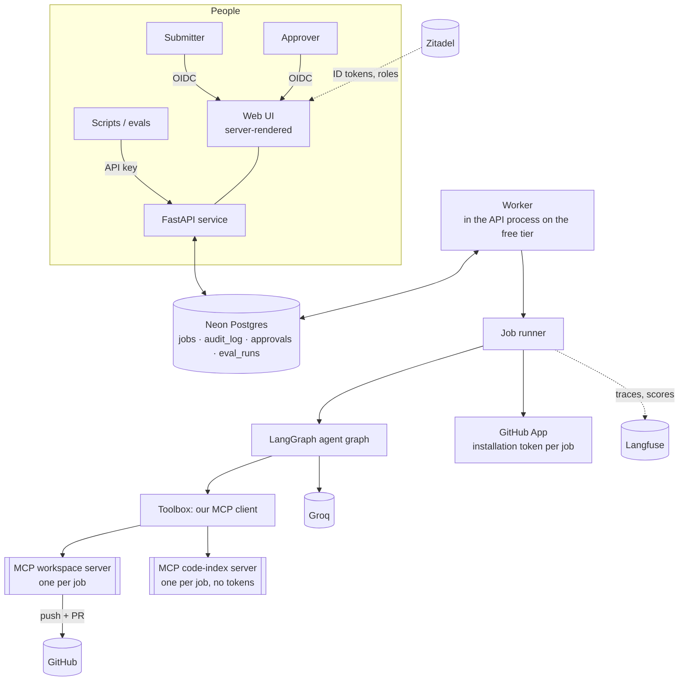
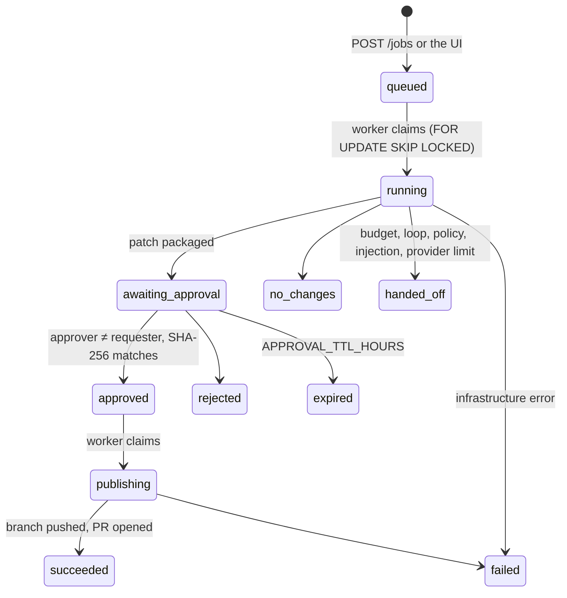
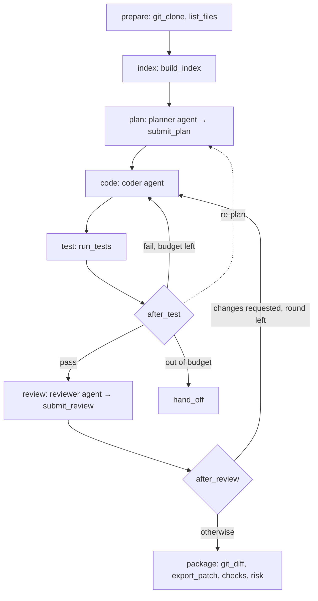

# Architecture

How the governed coding agent is put together, as of v1.0.0. The decisions behind it are in the
[ADRs](#decision-records); the threat model is in [threat-model.md](threat-model.md).

## System



| Component | Responsibility | ADR |
|---|---|---|
| **FastAPI service** | JSON job API (API keys), web UI (OIDC), health, version, `/metrics` | 0012, 0013 |
| **Worker** | Claims jobs from the Postgres queue, heartbeats, runs coding and publishing, recovers stale jobs, expires approvals | 0002, 0007 |
| **Job runner** | Sets up one job: the GitHub token, MCP servers, budgets, the trace; turns any error into a job state | 0010, 0011 |
| **Agent graph** (LangGraph) | Planner, coder, tester, reviewer, packager, with a code router between them | 0008 |
| **Toolbox** | Our MCP client: per-role allowlists, policy checks, loop detection, redaction, injection scan, audit, tracing | 0005, 0011 |
| **MCP workspace server** | Files, allow-listed test commands, git (clone, diff, patch export and apply, push, PR) inside one job folder | 0005, 0006 |
| **MCP code-index server** | Builds and searches the per-job index; read-only, gets no credentials | 0009 |
| **Retrieval** (LlamaIndex) | Syntax-aware chunks (tree-sitter), paragraph chunks for text, BM25 plus optional local embeddings, fused with RRF | 0009 |
| **Postgres** (Neon) | Queue, results, append-only audit log, approvals, eval results; governance rules enforced by triggers | 0002, 0004 |
| **Langfuse** | One trace per job; scores for status, risk, cost, duration and eval results | 0013 |
| **Zitadel** | Sign-in (OIDC with PKCE) and the `submitter` and `approver` roles | 0012 |
| **GitHub App** | The agent's identity: one-hour tokens limited to one repository | 0010 |

One Docker image runs everything. API and worker can be separate processes; on the free tier the
worker runs inside the API process (`RUN_WORKER_IN_API=true`), and splitting them is only a
configuration change.

## Job lifecycle



- **Coding run:** clone, index, plan, then code and test, with fix rounds and an optional
  re-plan. Then review, with an optional extra coder round, then package.
- **Package:**
  - export the patch and its SHA-256
  - refuse a patch that contains a secret or breaks the policy (protected paths, size limits)
  - assign a risk level with reasons
- **Publish run:** after approval, from a *fresh* clone. The workspace server refuses any patch
  whose SHA-256 differs from the approved one, so exactly what was reviewed is what gets pushed
  (ADR 0006).
- **Recovery:** a worker heartbeats every `WORKER_HEARTBEAT_SECONDS`. When a job's heartbeat is
  older than `WORKER_STALE_AFTER_SECONDS`, the job is requeued, or failed after
  `WORKER_MAX_CLAIMS` claims. A stale `publishing` job is failed, never retried, because a push
  may already have happened.

## Inside a coding run



| Step | Actor in the audit log | LLM | Tools |
|---|---|---|---|
| Prepare | `setup` | no | `git_clone`, `list_files` |
| Index | `indexer` | no | `build_index` |
| Plan | `planner` | yes | `read_file`, `list_files`, `search_code`, `search_codebase`, `submit_plan` |
| Code | `coder` | yes | read tools, `write_file`, `replace_in_file` |
| Test | `tester` | no | `run_tests` (allow-listed commands, no shell, stripped environment) |
| Review | `reviewer` | yes | read tools, `git_diff`, `submit_review` |
| Route | `router`, or `supervisor` in LLM mode | only in LLM mode | `choose_next_step`, which proposes a step that the policy then validates |
| Package | `packager` | no | `git_diff`, `export_patch` |
| Publish | `publisher` | no | `git_clone`, `apply_patch`, `git_commit_and_push`, `open_pull_request` |

Structured outputs (plan, review, routing choice) are tool calls validated by Pydantic. An agent
that sends invalid arguments gets the errors back and tries again.

**Budgets** that end a job with a hand-off, never a loop:
- fix attempts, re-plans and review rounds
- LLM turns per agent and LLM calls per job
- cost per job (at list price) and wall-clock time per job
- the provider's daily limit

Daily spend across all jobs pauses the queue.

## Every tool call

```
agent ─► Toolbox
          1. role allowlist                   blocked → audit (policy_block) + error to the agent
          2. policy check (policy@vN#hash)     protected paths, test commands
          3. loop detection                    identical call, unchanged workspace
          4. MCP server call                   inside the job folder; no path escapes
          5. redact result, scan for injection flags raise the risk; a blocked action after one stops the job
          6. audit row + trace span            if the audit row can't be written, the job stops
```

## Data model

| Table | Purpose | Guarantees |
|---|---|---|
| `jobs` | The queue and every result: plan, review, routes, diff, patch, `diff_sha256`, test output, prompt versions, LLM calls, tokens, cost, risk level, policy findings, duration | Constrained status values |
| `audit_log` | Every tool call, policy block, state change and decision | **Append-only:** UPDATE, DELETE and TRUNCATE rejected by triggers |
| `approvals` | One decision per job, bound to `diff_sha256` | **Approver ≠ requester**, enforced by a trigger |
| `eval_runs` | Golden-task results per model and commit (`--record-db`) | |

Migrations are hand-written SQL run by Alembic. CI applies them, rolls them back and applies them
again.

## Observability

- **Logs:** JSON with `request_id` and `job_id` on every line.
- **Traces:** one Langfuse trace per job, with a trace ID derived from the job ID, so the UI links
  to it without storing anything. Inside:
  - a span per graph step
  - a generation per LLM call: prompt version, tokens, cost, the prompt, the task and recent
    turns
  - a span per tool call

  Coding and publishing share one trace. Everything is redacted before export.
- **Ops page and `/metrics`:** SLOs and operating numbers computed from Postgres. The SLOs and
  what to do when one is missed are in the [runbook](runbook.md#slos).

| Endpoint | Meaning | Used by |
|---|---|---|
| `/healthz` | Process is alive | Northflank liveness probe |
| `/readyz` | Database reachable | Readiness probe, deploy smoke test |
| `/version` | Running commit SHA | Deploy smoke test |
| `/metrics` | Prometheus text (readers in `METRICS_READERS`) | Optional scraper |

## Evaluations

- **Golden tasks:** run the real pipeline against local fixture repositories, then grade with
  hidden tests, scope rules and safety checks. Offline runs replay reference solutions on every
  PR; live runs use the real LLM.
- **Retrieval eval:** scores code search on labelled questions.

See [evals.md](evals.md).

## Decision records

| ADR | Decision |
|---|---|
| [0001](adr/0001-record-architecture-decisions.md) | Record architecture decisions |
| [0002](adr/0002-postgres-as-job-queue.md) | Postgres (Neon) is the job queue |
| [0003](adr/0003-build-once-deploy-by-sha.md) | Build once in CI, deploy the image by commit SHA |
| [0004](adr/0004-governance-enforced-in-database.md) | Key governance rules are also enforced by the database |
| [0005](adr/0005-own-mcp-client-toolbox.md) | MCP tools are wrapped in our own governed Toolbox |
| [0006](adr/0006-approval-bound-to-patch.md) | Approval is bound to the exact patch; publishing re-applies it |
| [0007](adr/0007-embedded-worker-on-free-tier.md) | The worker runs inside the API process on the free tier |
| [0008](adr/0008-deterministic-supervisor.md) | Code routes between agents; an LLM supervisor may only propose |
| [0009](adr/0009-code-retrieval.md) | Per-job hybrid code index behind an MCP server |
| [0010](adr/0010-github-app-identity.md) | The agent acts as a GitHub App with per-job, one-repository tokens |
| [0011](adr/0011-policy-as-code-and-budgets.md) | Governance policy as a versioned file; budgets bound cost and time |
| [0012](adr/0012-web-ui-and-oidc-sign-in.md) | Server-rendered UI with OIDC sign-in (Zitadel) |
| [0013](adr/0013-tracing-and-ops-metrics.md) | Langfuse tracing per job; SLOs from Postgres |
| [0014](adr/0014-evaluation-strategy.md) | Golden tasks graded by hidden tests; a labelled retrieval set |
